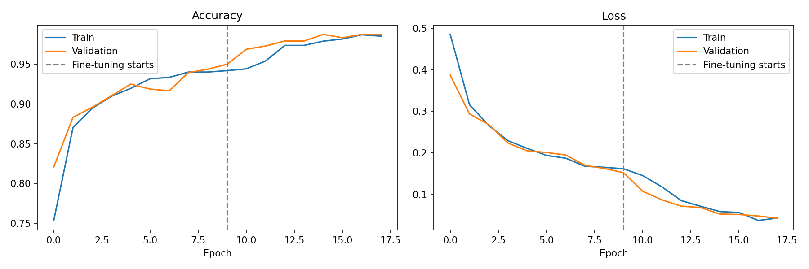
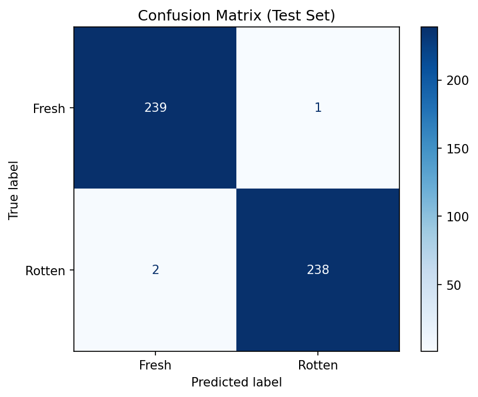
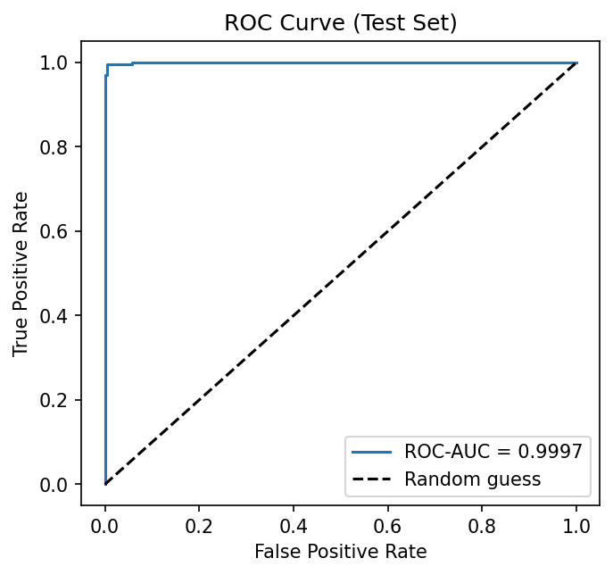

# 🍎 Food Freshness Detection Using Deep Learning & Streamlit

[](https://www.python.org/)
[](https://www.tensorflow.org/)
[](https://streamlit.io/)
[](https://keras.io/api/applications/mobilenet/)
[](results/metrics_with_splits.json)
[](results/roc_curve.png)
[](https://creativecommons.org/licenses/by/4.0/)

An end-to-end computer vision solution for automated fruit freshness classification. Built with **MobileNetV2** transfer learning in TensorFlow/Keras and deployed as a real-time, interactive **Streamlit** web application supporting both file uploads and live camera capture.

---

## 📌 Table of Contents

- [Overview](#-overview)
- [Key Features](#-key-features)
- [Model Architecture & Pipeline](#-model-architecture--pipeline)
- [Dataset & Stratification](#-dataset--stratification)
- [Experimental Results & Metrics](#-experimental-results--metrics)
- [Visualizations](#-visualizations)
- [Repository Structure](#-repository-structure)
- [Quick Start & Local Setup](#-quick-start--local-setup)
- [Training on Google Colab](#-training-on-google-colab)
- [Automated Report Generator](#-automated-report-generator)
- [Deployment on Streamlit Cloud](#-deployment-on-streamlit-cloud)
- [Troubleshooting](#-troubleshooting)
- [Citation & Acknowledgments](#-citation--acknowledgments)

---

## 🌟 Overview

Post-harvest food waste and spoiled produce cause massive economic losses across the agricultural supply chain and pose serious health risks to consumers. Manual fruit quality inspection is subjective, labor-intensive, and error-prone.

This project delivers a fast, automated, and lightweight classification pipeline that inspects fruit images and accurately classifies them as **Fresh** or **Rotten**. By utilizing **MobileNetV2** transfer learning, the system achieves **99.38% test accuracy** while remaining compact enough (~21 MB) to run smoothly on edge devices and free cloud tiers without dedicated GPU hardware.

---

## 🚀 Key Features

- **High-Accuracy Classification**: 99.38% accuracy and 0.9997 ROC-AUC across 8 fruit varieties.
- **Lightweight Architecture**: Transfer learning with MobileNetV2 (~21 MB model size, low inference latency).
- **Interactive Streamlit Web App**:
  - 📁 **File Upload Mode**: Upload `.jpg`, `.jpeg`, or `.png` fruit images.
  - 📷 **Live Camera Mode**: Snap pictures directly using your laptop or smartphone camera.
  - 📊 **Probabilistic Output**: Displays predicted class, percentage confidence, and individual class distribution bars.
  - ⚠️ **Out-of-Distribution Warning**: Alerts the user when prediction confidence is below 70%, guarding against ambiguous or unsupported fruit images.
  - 🔄 **EXIF Orientation Correction**: Automatically adjusts rotated smartphone photos.
- **Zero-Setup Colab Notebook**: Self-contained Google Colab notebook that directly streams the dataset from Hugging Face without manual archive downloads.
- **Automated Academic Report Sync**: Built-in script (`tools/fill_report.py`) that syncs experimental outputs directly into Word documentation (`reports/Food_Freshness_Detection_Project_Record.docx`).

---

## 🧠 Model Architecture & Pipeline

The system uses **MobileNetV2** pre-trained on ImageNet as a feature extractor, combined with a custom classification head optimized for binary freshness detection.

```
Input Image (RGB, variable size)
        │
        ▼
Preprocessing & EXIF Transposition
        │
        ▼
Resize to 224 × 224 × 3
        │
        ▼
MobileNetV2 Preprocessing Layer (scales pixels to [-1, 1])
        │
        ▼
MobileNetV2 Base (Pre-trained on ImageNet, Frozen / Feature Extractor)
        │
        ▼
GlobalAveragePooling2D
        │
        ▼
Dropout Layer (Rate = 0.2)
        │
        ▼
Dense Layer (1 Unit, Sigmoid Activation)
        │
        ▼
Output: P(Rotten) ∈ [0.0, 1.0] ──► Fresh (< 0.5) or Rotten (≥ 0.5)
```

### Training Specifications
- **Optimizer**: Adam (learning rate = $1 \times 10^{-4}$)
- **Loss Function**: Binary Cross-Entropy
- **Batch Size**: 32
- **Image Dimensions**: $224 \times 224 \times 3$
- **Epochs**: 18 (with early stopping / validation tracking)

---

## 📊 Dataset & Stratification

The model is trained on the benchmark **Fresh and Rotten Fruits** dataset by Sultana et al. (2022), hosted on Hugging Face (`Project-AgML/fresh_rotten_fruit_classification`).

- **Total Images**: 3,200
- **Fresh Images**: 1,600
- **Rotten Images**: 1,600
- **Fruit Varieties (8)**: Apple, Banana, Grape, Guava, Jujube, Orange, Pomegranate, Strawberry (400 images per fruit: 200 fresh, 200 rotten).
- **Split Ratio**: 70% Train, 15% Validation, 15% Test (Stratified by fruit type and freshness label).

### Data Split Distribution

| Split | Total Images | Fresh Images | Rotten Images | Proportion |
| :--- | :---: | :---: | :---: | :---: |
| **Train** | 2,240 | 1,120 | 1,120 | 70% |
| **Validation** | 480 | 240 | 240 | 15% |
| **Test** | 480 | 240 | 240 | 15% |
| **Total** | **3,200** | **1,600** | **1,600** | **100%** |

---

## 📈 Experimental Results & Metrics

Evaluation on the independent **480-image held-out test set** yielded state-of-the-art results:

### Test Set Performance Summary

| Metric | Score | Percentage |
| :--- | :---: | :---: |
| **Accuracy** | `0.9938` | **99.38%** |
| **Precision (Rotten)** | `0.9958` | **99.58%** |
| **Recall (Rotten)** | `0.9917` | **99.17%** |
| **F1-Score (Rotten)** | `0.9937` | **99.37%** |
| **ROC-AUC** | `0.9997` | **99.97%** |

### Confusion Matrix

| | Predicted Fresh | Predicted Rotten | Total |
| :--- | :---: | :---: | :---: |
| **Actual Fresh** | **239** *(True Negative)* | **1** *(False Positive)* | 240 |
| **Actual Rotten** | **2** *(False Negative)* | **238** *(True Positive)* | 240 |

> Only **3 misclassifications out of 480 test images** across all 8 fruit categories.

### Per-Fruit Accuracy Breakdown

| Fruit Variety | Total Test Images | Fresh / Rotten Count | Accuracy | Misclassifications |
| :--- | :---: | :---: | :---: | :---: |
| 🍎 **Apple** | 60 | 30 / 30 | **100.0%** | 0 |
| 🍌 **Banana** | 60 | 30 / 30 | **100.0%** | 0 |
| 🍇 **Grape** | 60 | 30 / 30 | **98.33%** | 1 |
| 🍈 **Guava** | 60 | 30 / 30 | **98.33%** | 1 |
| 🌰 **Jujube** | 60 | 30 / 30 | **98.33%** | 1 |
| 🍊 **Orange** | 60 | 30 / 30 | **100.0%** | 0 |
| 🫐 **Pomegranate** | 60 | 30 / 30 | **100.0%** | 0 |
| 🍓 **Strawberry** | 60 | 30 / 30 | **100.0%** | 0 |

---

## 📉 Visualizations

### 1. Training & Validation Curves
The model converges rapidly within 18 epochs without exhibiting overfitting. Both training and validation curves remain tightly aligned.



### 2. Confusion Matrix & ROC Curve
The confusion matrix confirms balanced classification with near-zero false alarms, and the ROC curve demonstrates an Area Under the Curve (AUC) of 0.9997.

| Confusion Matrix | ROC Curve |
| :---: | :---: |
|  |  |

---

## 📁 Repository Structure

```
food-freshness-detection/
├── .streamlit/
│   └── config.toml               # Streamlit theme and upload size settings
├── model/
│   ├── food_freshness_model.keras # Trained MobileNetV2 model (~21 MB)
│   ├── metrics.json              # Evaluation metrics loaded into the app
│   └── README.md                 # Model notes and specifications
├── notebooks/
│   └── Food_Freshness_Detection.ipynb # Complete training notebook (Google Colab)
├── reports/
│   └── Food_Freshness_Detection_Project_Record.docx # Full academic project record
├── results/
│   ├── confusion_matrix.png      # Confusion matrix plot
│   ├── metrics_with_splits.json  # Comprehensive metric outputs with split counts
│   ├── per_fruit_accuracy.csv    # Accuracy breakdown per fruit type
│   ├── roc_curve.png             # Receiver Operating Characteristic plot
│   └── training_curves.png       # Loss and accuracy progression across epochs
├── tools/
│   └── fill_report.py            # Automated script to populate Word doc with metrics
├── .gitignore                    # Git ignore file for Python/Streamlit/OS artifacts
├── app.py                        # Streamlit web application entry point
├── README.md                     # Project documentation
└── requirements.txt              # Production Python dependencies
```

---

## 💻 Quick Start & Local Setup

### 1. Clone the Repository
```bash
git clone https://github.com/chay2405/food-freshness-detection.git
cd food-freshness-detection
```

### 2. Create and Activate a Virtual Environment
> **Note**: Python 3.10 or 3.11 is recommended for optimal TensorFlow compatibility.

- **On macOS / Linux**:
  ```bash
  python3 -m venv .venv
  source .venv/bin/activate
  ```

- **On Windows (Command Prompt / PowerShell)**:
  ```powershell
  python -m venv .venv
  .venv\Scripts\activate
  ```

### 3. Install Dependencies
```bash
pip install --upgrade pip
pip install -r requirements.txt
```

### 4. Run the Streamlit Application
```bash
streamlit run app.py
```
The application will launch in your default web browser at `http://localhost:8501`.

---

## ⚡ Training on Google Colab

If you wish to re-train the model or experiment with different architectures:

1. Open [Google Colab](https://colab.research.google.com/).
2. Navigate to **File** → **Upload notebook** and upload `notebooks/Food_Freshness_Detection.ipynb`.
3. Set your hardware accelerator: **Runtime** → **Change runtime type** → select **T4 GPU**.
4. Run all cells (**Runtime** → **Run all**).
5. The notebook automatically:
   - Downloads the `Project-AgML/fresh_rotten_fruit_classification` dataset from Hugging Face.
   - Preprocesses and stratifies the images.
   - Trains the MobileNetV2 model with transfer learning.
   - Evaluates test-set performance and generates all curves.
   - Packages `project_outputs.zip` containing the new `.keras` model, JSON metrics, and visualization plots.
6. Extract `project_outputs.zip` and place `food_freshness_model.keras` and `metrics.json` into the `model/` directory.

---

## 📝 Automated Report Generator

To automatically sync the latest training results, tables, and figures into the Word project report:

```bash
pip install python-docx
python tools/fill_report.py --outputs results --docx reports/Food_Freshness_Detection_Project_Record.docx
```

This updates:
1. **Split counts table** (Train, Validation, Test image counts).
2. **Metrics table** (Accuracy, Precision, Recall, F1, ROC-AUC).
3. **Per-fruit accuracy table**.
4. **Embedded plots** (Training curves, confusion matrix, ROC curve).

---

## ☁️ Deployment on Streamlit Cloud

The app is pre-configured for free one-click deployment on **Streamlit Community Cloud**:

1. Fork or push this repository to your GitHub account.
2. Sign in to [share.streamlit.io](https://share.streamlit.io/) with your GitHub account.
3. Click **New app** and configure:
   - **Repository**: `chay2405/food-freshness-detection`
   - **Branch**: `main`
   - **Main file path**: `app.py`
4. Expand **Advanced settings**:
   - Select **Python 3.11** (TensorFlow CPU is fully supported).
5. Click **Deploy!** Your app will be live with a shareable public URL.

---

## 🔧 Troubleshooting

| Issue | Cause | Solution |
| :--- | :--- | :--- |
| **"No trained model found"** | `food_freshness_model.keras` missing from `model/`. | Ensure `model/food_freshness_model.keras` is tracked and committed, or upload it via the UI prompt. |
| **"Model could not be loaded"** | Keras/TensorFlow version mismatch. | Pin `tensorflow-cpu==<version>` in `requirements.txt` matching your training runtime. |
| **Build fails on Streamlit Cloud** | Incompatible Python runtime selected. | In Streamlit Cloud *Advanced Settings*, ensure Python 3.10 or 3.11 is selected. |
| **Low confidence warning** | Out-of-distribution image or poor lighting. | Test with clear, well-lit photos of the 8 supported fruit varieties. |
| **Rotated image on upload** | Missing EXIF orientation metadata. | Handled automatically by PIL `ImageOps.exif_transpose` in `app.py`. |

---

## 📚 Citation & Acknowledgments

### Dataset Citation
```bibtex
@article{sultana2022extensive,
  title={An extensive dataset for successful recognition of fresh and rotten fruits},
  author={Sultana, Nasrin and Jahan, Munmun and Uddin, Mohammad Shorif},
  journal={Data in Brief},
  volume={44},
  pages={108552},
  year={2022},
  publisher={Elsevier},
  doi={10.1016/j.dib.2022.108552}
}
```

### Architecture Citation
```bibtex
@inproceedings{sandler2018mobilenetv2,
  title={MobileNetV2: Inverted Residuals and Linear Bottlenecks},
  author={Sandler, Mark and Howard, Andrew and Zhu, Menglong and Zhmoginov, Andrey and Chen, Liang-Chieh},
  booktitle={Proceedings of the IEEE Conference on Computer Vision and Pattern Recognition (CVPR)},
  pages={4510--4520},
  year={2018}
}
```

---

## 📄 License

- **Code & Application**: [MIT License](LICENSE)
- **Dataset**: [Creative Commons Attribution 4.0 International (CC BY 4.0)](https://creativecommons.org/licenses/by/4.0/)
